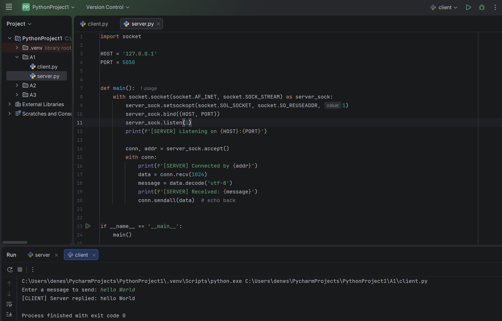
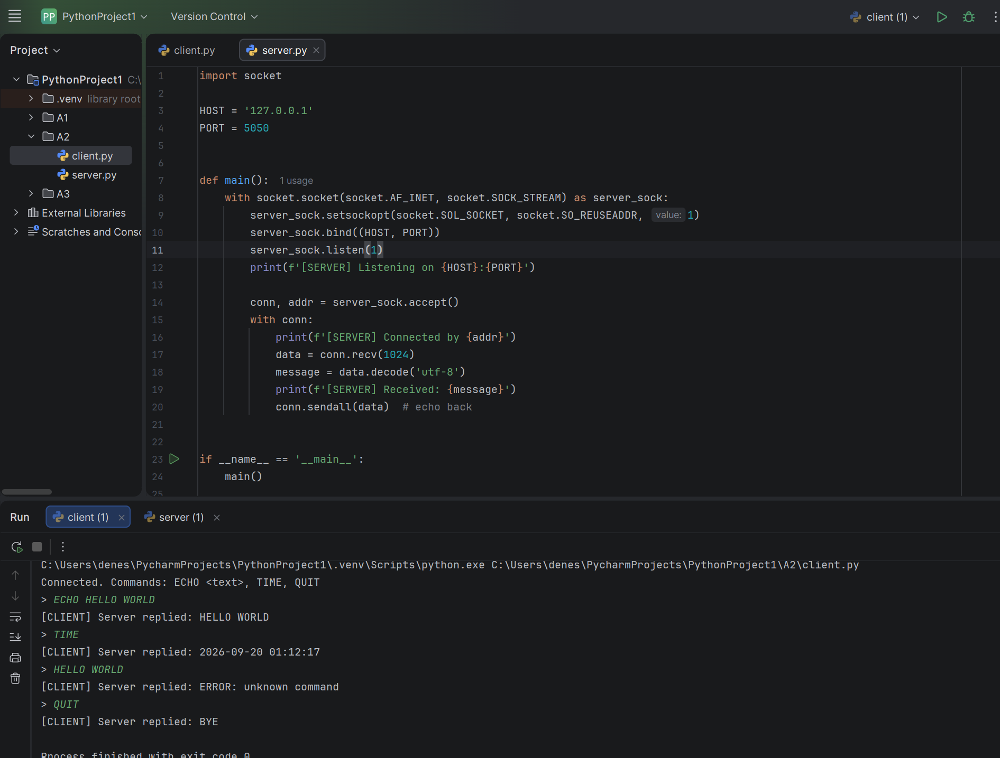
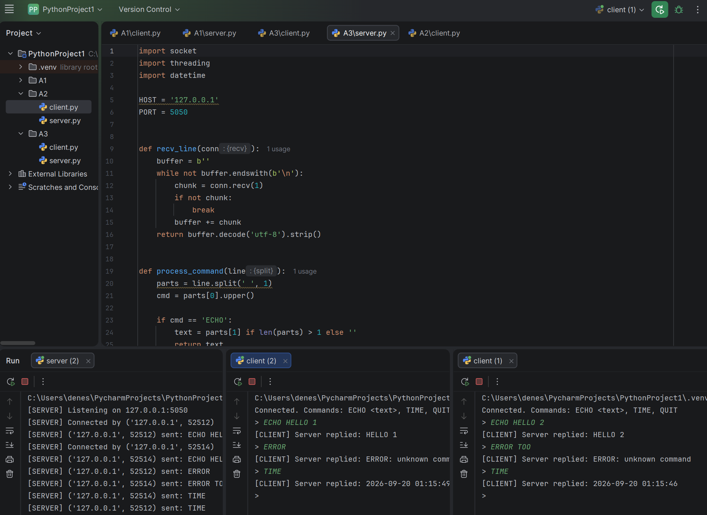

# Lab Report — Part A: TCP Client-Server
Essaulov Denis

For Part A I built a minimal TCP echo server (A1), extended it into a small line-based command protocol with ECHO, TIME, and QUIT (A2), and then made the server multi-threaded so it could handle several clients at once (A3). Everything was tested locally on 127.0.0.1:5050; screenshots of each stage are below.

## Reflection Questions

### 1. Listening socket vs. the socket accept() returns

The listening socket never actually talks to a client — its only job is to sit on port 5050 and wait for connection requests. Every time `accept()` runs, the OS hands back a brand-new socket tied to one specific client (its IP and port), and that's the socket `recv()`/`sendall()` actually use. The listening socket just keeps waiting for the next client to show up.

### 2. Why a single-threaded server without a loop can only serve one client

Because it's all one thread. Once the server calls `accept()` and starts talking to a client, it's stuck in that conversation and can't call `accept()` again until that client is done. A second client isn't rejected outright — the TCP handshake can still complete and the connection just sits in the backlog queue, on hold. It only gets served once the first client disconnects and the loop goes back around to `accept()`.

### 3. Limitations of the A2 protocol vs. something like HTTP

- No real framing, just a newline — a message that contains a newline would break it. HTTP uses Content-Length or chunking, so it doesn't matter what's inside the body.
- No headers or metadata — no content type, no auth, no versioning. HTTP has all of that built in.
- No status codes — errors are a plain-text string I'd have to pattern-match. HTTP has 200/404/500 etc. that any client can handle without guessing.

### 4. Why cloud infrastructure matters for a distributed systems course

Everything here ran on one machine over loopback, which skips the actually hard parts of distributed systems: real network latency, machines failing independently, scaling under load. That's why AWS matters for a course like this — it's where you get genuinely separate machines talking over a real network instead of just threads on one CPU. As an example, the A3 threaded server could just as easily run on an EC2 instance (bound to 0.0.0.0, with the security group opening port 5050) instead of localhost, and then real clients from anywhere could connect to it concurrently instead of just other terminals on my own laptop.

## Difficulties Along the Way

A few small headaches. Restarting the server right after stopping it sometimes threw "address already in use" — `SO_REUSEADDR` took care of that. I also had `recv_line()` hang once because I forgot to add `\n` to a command on the client side, so the server just sat there waiting for a line ending that was never coming. And once I got two clients running through the A3 server, the print statements in the console got interleaved and confusing until I added each client's address to every log line so I could tell them apart.

## Screenshots

**1. Local echo test (A1)**

**2. Multi-command session (A2)**

**3. Two concurrent clients (A3)**

